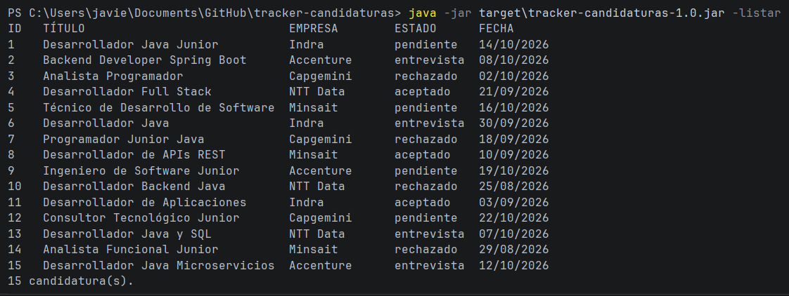
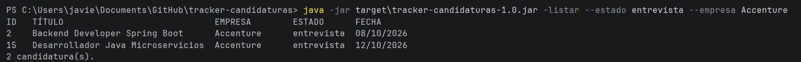
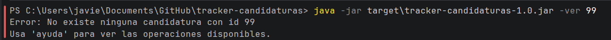

# CandiTrack — Tracker de Candidaturas Laborales

Aplicación Java para hacer seguimiento de candidaturas a ofertas de empleo o prácticas.
Proyecto integrador del 1.er trimestre (Acceso a Datos + Desarrollo de Interfaces).

**Equipo:** Javier Peña · Daniel García

## Versiones

| Tag  | Contenido                                             | Estado       |
|------|-------------------------------------------------------|--------------|
| v1.0 | Persistencia en ficheros + CLI + prototipo Figma + Manual de estilo | Entregada |
| v2.0 | JDBC + JavaFX (Scene Builder)                          | Pendiente    |
| v3.0 | Hibernate + JavaFX avanzado + Ollama4j                 | Pendiente    |

## Tecnologías (v1.0)

- Java 24 · Maven
- Persistencia en fichero de texto plano (CSV con `;`)
- JUnit 5 + Mockito para las pruebas unitarias
- Figma (prototipo) · Manual de estilo en PDF

*(Se ampliará con JDBC, Hibernate, JavaFX, Scene Builder y Ollama en v2.0 y v3.0.)*

## Compilar y ejecutar (v1.0)

```bash
mvn clean package
java -jar target/tracker-candidaturas-1.0.jar -importar data/candidaturas.csv
java -jar target/tracker-candidaturas-1.0.jar -listar
```

El fichero de datos es `data/candidaturas.txt` (se crea al guardar). Se puede cambiar con la
variable de entorno `TRACKER_DATA`:

```bash
# Linux / macOS
TRACKER_DATA=/ruta/mis_datos.txt java -jar target/tracker-candidaturas-1.0.jar -listar
# Windows (PowerShell)
$env:TRACKER_DATA="C:\ruta\mis_datos.txt"; java -jar target\tracker-candidaturas-1.0.jar -listar
```

Ejecutar los tests: `mvn test`


### Ejemplos de uso

Listado completo:



Filtro por estado y empresa:



Error por id inexistente:




### Operaciones

| Comando | Descripción |
|---------|-------------|
| `-listar` | Lista todas las candidaturas |
| `-listar --estado entrevista --empresa Indra` | Filtra por estado (exacto) y/o empresa (contiene el texto) |
| `-añadir --titulo "Dev Java" --empresa "Indra" --estado pendiente --fecha 26/10/2026` | Añade una candidatura. `--fecha` (por defecto hoy), `--enlace` y `--notas` son opcionales |
| `-ver 13` | Muestra el detalle de la candidatura 13 |
| `-borrar 13` | Elimina la candidatura 13 |
| `-importar data/candidaturas.csv` | Importa candidaturas desde un CSV (si un id ya existe, se asigna el siguiente libre) |
| `ayuda` | Muestra la ayuda |

Estados válidos: `pendiente`, `entrevista`, `rechazado`, `aceptado`.
El guion inicial de la operación es opcional (`-listar` = `listar`).
Si la consola no muestra bien la `ñ`, usa `-anadir` (alias equivalente).

Los errores (argumentos faltantes, fichero no encontrado, id inexistente, fecha o estado no válidos)
se muestran por consola con un mensaje claro y el programa termina con código de salida 1.

## Estructura

```
src/main/java/com/tracker
├── Main.java                  Punto de entrada
├── cli/                       Interpretación de argumentos y ejecución de comandos
├── model/                     Candidatura (record) y Estado (enum)
├── repository/                Interfaz + implementación sobre fichero de texto
├── service/                   Lógica de negocio (filtros, altas, bajas, importación)
└── exception/                 TrackerException
data/candidaturas.csv          Datos de prueba (15 registros)
docs/                          Prototipo (PDF) y Manual de estilo (PDF)
```

## Datos de prueba

[`data/candidaturas.csv`](data/candidaturas.csv): 15 candidaturas, 5 empresas, entre 3 y 4 por estado,
con fechas de agosto a octubre de 2026. Generado con IA a partir de la plantilla del enunciado
(ver `AGENTS.md`).

## Diseño

- Prototipo Figma (solo lectura): **[PEGAR ENLACE AQUÍ]**
- Pantallas del prototipo: [`docs/CandiTrack_Prototipo_v1.0.pdf`](docs/CandiTrack_Prototipo_v1.0.pdf)
- Manual de estilo: [`docs/CandiTrack_Manual_de_Estilo_v1.0.pdf`](docs/CandiTrack_Manual_de_Estilo_v1.0.pdf)

## Contribuciones

| Miembro | v1.0 | v2.0 | v3.0 |
|---------|------|------|------|
| Javier Peña | [Compilación y pruebas del código Java (CLI, servicio y repositorio), ejecución de los tests con Maven, repositorio de GitHub, datos de prueba y vídeo de los comandos] | | |
| Daniel García | [p. ej. CLI, prototipo Figma, manual de estilo, vídeo] | | |
