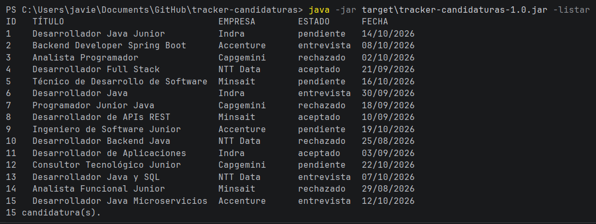
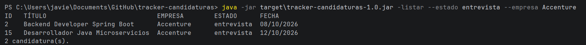
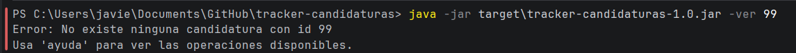

# CandiTrack — Tracker de Candidaturas Laborales

Aplicación Java para hacer seguimiento de candidaturas a ofertas de empleo o prácticas.
Proyecto integrador del 1.er trimestre (Acceso a Datos + Desarrollo de Interfaces).

**Equipo:** Javier Peña · Daniel García

## Versiones

| Tag  | Contenido                                                           | Estado     |
|------|---------------------------------------------------------------------|------------|
| v1.0 | Persistencia en ficheros + CLI + prototipo Figma + Manual de estilo | Implementada; revisión final y entrega por confirmar |
| v2.0 | JDBC (MySQL) + JavaFX (Scene Builder)                               | Implementada; revisión final y entrega por confirmar |
| v3.0 | Hibernate + JavaFX avanzado + Ollama4j                              | Pendiente  |

## Tecnologías

**v1.0**

- Java 24 · Maven
- Persistencia en fichero de texto plano (CSV con `;`)
- JUnit 5 + Mockito para las pruebas unitarias
- Figma (prototipo) · Manual de estilo en PDF

**v2.0** (se añade a lo anterior)

- MySQL 8 con JDBC (`mysql-connector-j`)
- JavaFX 24 · FXML · Scene Builder · hoja de estilos CSS
- H2 en memoria (pruebas de los repositorios)

*(Se ampliará con Hibernate y Ollama en la v3.0.)*

---

# Versión 1.0 — Archivos + CLI + Diseño

## Compilar y ejecutar (v1.0)

Estas instrucciones corresponden a la etiqueta `v1.0` (`git checkout v1.0`), donde el proyecto genera un JAR
ejecutable.

```bash
mvn clean package
java -jar target/tracker-candidaturas-1.0.jar -importar data/candidaturas.csv
java -jar target/tracker-candidaturas-1.0.jar -listar
```

En la rama `main` (v2.0) la interfaz principal es JavaFX, pero la consola se conserva y se puede lanzar tras
compilar con `java -cp target/classes com.tracker.Main -listar`.

El fichero de datos es `data/candidaturas.txt` (se crea al guardar). Se puede cambiar con la
variable de entorno `TRACKER_DATA`:

```bash
# Linux / macOS
TRACKER_DATA=/ruta/mis_datos.txt java -jar target/tracker-candidaturas-1.0.jar -listar
# Windows (PowerShell)
$env:TRACKER_DATA="C:\ruta\mis_datos.txt"; java -jar target\tracker-candidaturas-1.0.jar -listar
```

### Pruebas

Con Java 24 y Maven, desde la raíz del proyecto, ejecuta `mvn test` para lanzar las
pruebas o `mvn clean package` para limpiar, compilar, probar y generar el JAR.
En IntelliJ: ventana **Maven** → **Execute Maven Goal** → `mvn clean package`.
Antes de cada commit se comprueba que aparece **BUILD SUCCESS**.

La suite de la v1.0 contiene 54 pruebas con JUnit 5: 14 de `CommandLine` (argumentos y errores),
8 de `CommandRunner` (listar vacío y con filtros, añadir, ver, borrar, operación
desconocida y rechazos sin modificar el fichero), 16 del servicio con Mockito y 16 del repositorio (lectura, escritura,
fichero inexistente o vacío y registros con fecha, campos, estado o id incorrectos).
Las fechas se validan estrictamente: se rechazan días imposibles y el 29 de febrero
solo se admite en años bisiestos, tanto al añadir como al leer un fichero.
Cada registro debe tener exactamente 7 campos; enlace y notas pueden estar vacíos,
pero deben conservar sus separadores. Se rechazan los campos ausentes o sobrantes.
El título y la empresa son obligatorios también al importar: se rechazan tanto los
valores vacíos como los que solo contienen espacios. Si una fila es inválida, no se
importa ninguna fila ni se modifica el fichero de destino.
Las opciones deben estar permitidas para la operación indicada; una errata como
`--estdo` produce un error en lugar de ignorarse.
Las pruebas de la CLI usan `@TempDir` y capturan la salida con
`ByteArrayOutputStream`; no modifican `data/candidaturas.txt`.

En el equipo Windows de Daniel, Mockito 5.14.2 ha necesitado una propiedad local
`argLine` en **Settings → Build Tools → Maven → Runner → Properties**, con el valor
`-Dnet.bytebuddy.experimental=true -javaagent:<ruta-al-jar-mockito-core-5.14.2.jar>`.
El JAR está en el repositorio local de Maven, bajo
`org/mockito/mockito-core/5.14.2/`. La ruta debe apuntar al JAR de cada equipo.
También se han usado rutas cortas de Windows sin acentos para Maven y su repositorio
local, debido a un error de codificación del lanzador de IntelliJ. Son ajustes
locales del entorno; el `pom.xml` no se ha modificado.

### Operaciones

| Comando | Descripción |
|---------|-------------|
| `-listar` | Lista todas las candidaturas |
| `-listar --estado entrevista --empresa Indra` | Filtra por estado (exacto) y/o empresa (contiene el texto) |
| `-listar --ordenar fecha` | Ordena el listado por `id` (por defecto), `fecha` (más recientes primero), `empresa` o `titulo`. Se puede combinar con los filtros |
| `-añadir --titulo "Dev Java" --empresa "Indra" --estado pendiente --fecha 26/10/2026` | Añade una candidatura. `--fecha` (por defecto hoy), `--enlace` y `--notas` son opcionales |
| `-ver 13` | Muestra el detalle de la candidatura 13 |
| `-borrar 13` | Elimina la candidatura 13 |
| `-importar data/candidaturas.csv` | Importa candidaturas desde un CSV (si un id ya existe, se asigna el siguiente libre) |
| `ayuda` | Muestra la ayuda |

Estados válidos: `pendiente`, `entrevista`, `rechazado`, `aceptado`.
El guion inicial de la operación es opcional (`-listar` = `listar`).
Si la consola no muestra bien la `ñ`, usa `-anadir` (alias equivalente).

Los errores (argumentos faltantes, fichero no encontrado, id inexistente, fecha, estado u orden no válidos)
se muestran por consola con un mensaje claro y el programa termina con código de salida 1.

### Ejemplos de uso

Listado completo:



Filtro por estado y empresa:



Error por id inexistente:



## Datos de prueba

[`data/candidaturas.csv`](data/candidaturas.csv): 15 candidaturas, 5 empresas, entre 3 y 4 por estado,
con fechas de agosto a octubre de 2026. Generado con IA a partir de la plantilla del enunciado
(ver `AGENTS.md`).

## Diseño

- Prototipo Figma (solo lectura): **https://www.figma.com/proto/1mqY4IMHFg4MyFbTKW7PJ2/CandiTrack---Prototipo-v1.0?node-id=7-582&p=f&viewport=605%2C531%2C0.22&t=2DE6i4E39VPtJebN-1&scaling=min-zoom&content-scaling=fixed&starting-point-node-id=7%3A582&page-id=0%3A1**
- Pantallas del prototipo: [`docs/CandiTrack_Prototipo_v1.0.pdf`](docs/CandiTrack_Prototipo_v1.0.pdf)
- Manual de estilo: [`docs/CandiTrack_Manual_de_Estilo_v1.0.pdf`](docs/CandiTrack_Manual_de_Estilo_v1.0.pdf)

El PDF de pantallas es la exportación final de Figma. La navegación debe comprobarse
en el enlace del prototipo: el PDF no acredita que todos los botones estén conectados.
El código Java de v1.0 implementa la CLI; las pantallas de empresas, entrevistas,
estadísticas y asistente anticipan las siguientes versiones.

`docs/tools/generar_pdfs.py` es una herramienta auxiliar para generar borradores,
no la exportación final de Figma. Requiere Python, ReportLab y las fuentes DejaVu.
Por defecto escribe en `docs/borradores/`, una carpeta excluida de Git, y añade
`_borrador` a los nombres de ambos PDF, incluso si se indica otro directorio.
Los PDF finales de `docs/` se mantienen separados y no se sustituyen al ejecutarla.

## Comprobaciones de entrega (v1.0)

- Revisar las diferencias entre `main` y el tag `v1.0` con el equipo antes de entregar:
  los commits posteriores al tag no quedan incluidos automáticamente en él.
- Confirmar la navegación y el acceso de solo lectura al prototipo, y revisar los
  documentos y enlaces desde otra sesión.
- Grabar un vídeo MP4 de 5–10 minutos, con participación de ambos miembros,
  mostrando la CLI y Figma funcionando. Su grabación y entrega están por confirmar.
- Cada miembro debe aportar al menos 5 commits sustanciales repartidos en al menos
  2 entregas; el número de commits de v1.0 no completa por sí solo ese requisito.

---

# Versión 2.0 — JDBC + JavaFX

Segunda entrega: la persistencia en ficheros se sustituye por una base de datos MySQL accedida con JDBC y la
interfaz de consola se sustituye por una aplicación gráfica JavaFX con las pantallas maquetadas en FXML
(Scene Builder) y estilizadas con el manual de estilo de la v1.0.

## Puesta en marcha

1. **Requisitos:** JDK 24 y un servidor MySQL 8 en marcha.
2. **Crear la base de datos:** ejecutar el script [`db/schema.sql`](db/schema.sql) (por ejemplo, con MySQL Workbench:
   *File → Open SQL Script → Run*). Crea la base `canditrack` con las tablas `EMPRESA`, `OFERTA` y `ENTREVISTA`.
3. **Configurar la conexión:** copiar [`config.properties.example`](config.properties.example) como
   `config.properties` y rellenar la URL, el usuario y la contraseña. Este archivo no se sube al repositorio
   (está en `.gitignore`). Alternativamente se pueden usar las variables de entorno `DB_URL`, `DB_USER` y
   `DB_PASSWORD`, que tienen prioridad sobre el fichero.
4. **Arrancar la aplicación:** `mvn javafx:run` (o desde IntelliJ, *Plugins → javafx → javafx:run*).
5. **Cargar los datos de prueba:** botón **Importar CSV…** del listado y elegir
   [`data/candidaturas.csv`](data/candidaturas.csv). Importar el mismo fichero dos veces no duplica datos.
6. **Pruebas:** `mvn test` o `mvn clean package`. Los tests de los repositorios usan H2 en memoria y no necesitan
   MySQL; la prueba de conexión real (`ConexionBdTest`) se omite si no hay configuración. En la última ejecución
   `mvn clean verify` terminó correctamente con JDK 27 y compilación para Java 24: 103 pruebas correctas, incluida la conexión a MySQL 8.4.
   El script `db/schema.sql` se verificó por separado en MySQL 8.4: creó las tres tablas y sus dos claves foráneas.

## Funcionalidades

| Historia de usuario | Implementación |
|---|---|
| HU-09 Listado en tabla | Pantalla *Candidaturas*: `TableView` ordenable por columna y con selección de filas |
| HU-10 Gestión de empresas | Pantalla *Empresas*: tabla con nº de ofertas y formulario de alta, edición y baja |
| HU-11 Entrevistas de cada oferta | Panel desplegable *Entrevistas* dentro del detalle, con formulario de alta, edición y baja |
| HU-12 Cambiar el estado | Desplegable en la propia tabla (doble clic) y en el detalle |
| HU-13 Filtros múltiples | Texto, estado, empresa, salario mínimo y máximo y rango de fechas, combinables |

Además: formulario de alta y edición de candidaturas con validación de campos, importación del CSV inicial a la
base de datos, borrado de candidaturas (con sus entrevistas) y mensajes de error claros en pantalla.

## Requisitos de Acceso a Datos cubiertos

- Esquema MySQL con claves foráneas (`OFERTA → EMPRESA`, `ENTREVISTA → OFERTA`) y `schema.sql`.
- Configuración de la conexión externalizada (`config.properties` o variables de entorno).
- Consultas con `JOIN` (ofertas con su empresa; entrevistas con su oferta y empresa) y `GROUP BY`
  (nº de ofertas por empresa), siempre con `PreparedStatement`.
- Filtros combinados con consulta construida dinámicamente (empresa + estado + salario, fecha + empresa, etc.).
- CRUD completo de empresas y entrevistas; cambio de estado de una candidatura.
- Transacción en la importación del CSV: crea las empresas que faltan y las ofertas en un único bloque; si algo
  falla se hace `rollback` y no se guarda nada.

## Esquema de la base de datos

| Tabla | Campos principales |
|---|---|
| `EMPRESA` | `id`, `nombre` (único), `sector`, `web`, `fechaRegistro` |
| `OFERTA` | `id`, `id_empresa` (FK), `titulo`, `descripcion`, `estado`, `fechaPostulacion`, `enlace`, `salario`, `notas` |
| `ENTREVISTA` | `id`, `id_oferta` (FK, borrado en cascada), `fecha`, `tipo`, `notas`, `resultado` |

## Diseño de la interfaz

Las pantallas siguen el prototipo de Figma y el manual de estilo de la v1.0. Los archivos `.fxml` se maquetan y
retocan con Scene Builder, y los estilos viven en
[`styles.css`](src/main/resources/com/tracker/css/styles.css), donde se asignan a los componentes mediante clases
CSS (`boton-primario`, `boton-secundario`, `boton-peligro`, `tarjeta`, `titulo`...).

---

## Estructura del código

```
src/main/java/com/tracker
├── App.java                   Arranque de JavaFX (v2.0)
├── Main.java                  Punto de entrada de la consola (v1.0)
├── cli/                       Interpretación de argumentos y ejecución de comandos (v1.0)
├── config/                    Lectura de la configuración y conexiones JDBC (v2.0)
├── model/                     Candidatura (v1.0); Empresa, Oferta, Entrevista y Estado
├── repository/                Repositorio de ficheros (v1.0) e interfaces y repositorios JDBC (v2.0)
├── service/                   Lógica de negocio y validación
├── controller/                Controladores JavaFX de cada pantalla (v2.0)
├── ui/                        Navegación, carga de FXML, alertas y formatos (v2.0)
└── exception/                 TrackerException
src/main/resources/com/tracker
├── view/                      Pantallas FXML (maquetadas con Scene Builder)
└── css/styles.css             Estilos según el manual de estilo
data/candidaturas.csv          Datos de prueba (15 registros)
db/schema.sql                  Esquema de la base de datos
docs/                          Prototipo (PDF), Manual de estilo (PDF) y capturas de la CLI
```

## Contribuciones

| Miembro | v1.0 | v2.0 | v3.0 |
|---------|------|------|------|
| Javier Peña | Compilación y pruebas del código Java (CLI, servicio y repositorio), ejecución de los tests con Maven, repositorio de GitHub, datos de prueba, opción `--ordenar` con sus tests y capturas de la CLI, prototipo interactivo en Figma (importación de pantallas y enlaces entre ellas) | Configuración de MySQL y Scene Builder, integración y prueba de la capa JDBC y de las pantallas JavaFX, estilos CSS aplicados en Scene Builder (listado y empresas) y documentación de la v2.0 | |
| Daniel García | Incorporación de 10 tests de CommandLine y 6 de CommandRunner con ficheros temporales y salida capturada; ampliación de las pruebas de servicio y repositorio para fechas imposibles, años bisiestos y registros de siete campos; validación estricta de fechas y campos; comprobación con Maven y documentación de las pruebas y la entrega, con asistencia de ChatGPT | Revisión del alcance de la v2.0 y prueba JDBC de los filtros combinados por empresa, estado y salario, con asistencia de ChatGPT. | |
